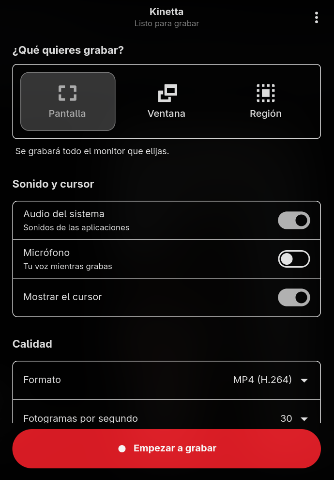
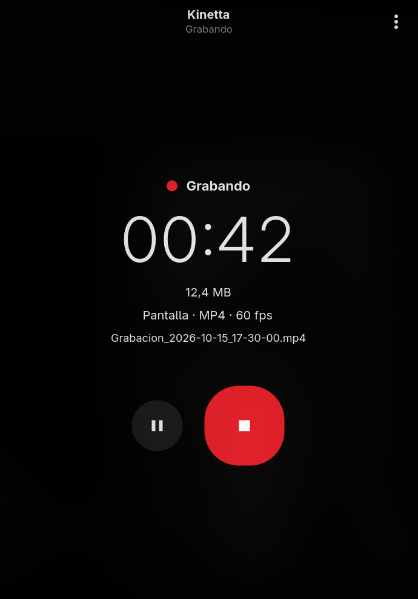
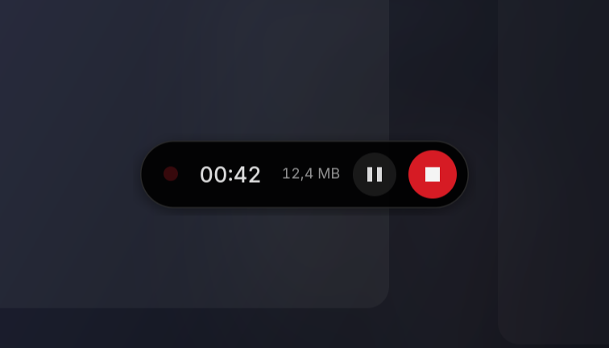

# Kinetta

A simple screen recorder for Linux, built with GTK4 and libadwaita.

*Leer en español: [README.es.md](README.es.md)*

> **Status: v0.3.** Real recording works through the `ScreenCast` portal
> (xdg-desktop-portal), PipeWire and GStreamer. Global shortcuts, translations
> and the Flathub release are still on the roadmap.

## Screenshots

| Set up | Recording |
| --- | --- |
|  |  |

The floating control bar stays on top of everything while recording:



## Features

- Record a **screen**, a **window** or a **region** (own region selector)
- System audio and microphone, mixed into one file
- MP4 (H.264), WebM (VP9) and GIF output (GIF needs ffmpeg)
- Four quality levels (up to 20 Mb/s at 1080p) and frame rate; the bitrate adapts to the screen size
- Countdown before recording starts
- **Real pause:** paused time does not appear in the video
- **Floating control bar** with timer, pause, stop and adjustable opacity
- Custom file name and the option to open the video when it is saved
- Keyboard shortcuts (`Ctrl`+`R` to record or stop, `Ctrl`+`Q` to quit)
- Native look and feel with GTK4 and libadwaita

## Run it

Install the dependencies. Besides GTK and PyGObject you need GStreamer (with
the PipeWire plugin) and a running xdg-desktop-portal with the backend of your
desktop:

```bash
# Debian / Ubuntu / Mint
sudo apt install python3-gi gir1.2-gtk-4.0 gir1.2-adw-1 \
  gstreamer1.0-plugins-base gstreamer1.0-plugins-good gstreamer1.0-plugins-bad \
  gstreamer1.0-plugins-ugly gstreamer1.0-pipewire \
  xdg-desktop-portal xdg-desktop-portal-gnome   # -kde / -wlr / -hyprland, according to your desktop
# optional, for GIF export:
sudo apt install ffmpeg

# Fedora
sudo dnf install python3-gobject gtk4 libadwaita \
  gstreamer1-plugins-base gstreamer1-plugins-good gstreamer1-plugins-bad-free \
  gstreamer1-plugin-pipewire xdg-desktop-portal-gnome
# H.264 encoding: sudo dnf install gstreamer1-plugins-ugly   (RPM Fusion)
# optional: sudo dnf install ffmpeg

# Arch
sudo pacman -S python-gobject gtk4 libadwaita gst-plugin-pipewire \
  gst-plugins-base gst-plugins-good gst-plugins-bad gst-plugins-ugly \
  xdg-desktop-portal xdg-desktop-portal-hyprland  # backend according to your desktop
# optional: sudo pacman -S ffmpeg
```

Then, from the project folder:

```bash
make run
```

Requires GTK 4.10+, libadwaita 1.4+ and GStreamer 1.22+.

### Install for your user (recommended)

Installs a `kinetta` command plus a menu entry in `~/.local`, without touching
the system:

```bash
make install     # PREFIX=~/.local by default
make uninstall
```

### Floating bar always on top (optional)

On **Hyprland** there is nothing to install: Kinetta asks `hyprctl` to keep the bar floating, above other windows and visible on every workspace. These are session rules; they go away when Hyprland restarts.

Hyprland can keep the bar out of recordings, but it does so by covering it with a black capsule that looks worse than the bar itself, so Kinetta does not use it: **when you record the screen or a region, the bar shows up in the video**. Lower its opacity in Controls if you want to make it discreet.

On **KDE Plasma, Sway or COSMIC**, install `gtk4-layer-shell` to keep the bar above other windows. Without it the bar works as a regular window (and the region selector uses a fullscreen window instead of an overlay on the exact monitor).

```bash
sudo apt install gir1.2-gtk4layershell-1.0   # Debian / Ubuntu
sudo dnf install gtk4-layer-shell            # Fedora
sudo pacman -S gtk4-layer-shell              # Arch
```

GNOME does not support this protocol, so the bar can't be forced on top there.

## Notes

- The portal asks for permission every time you start a recording (restore
  tokens are not implemented yet).
- In region mode, draw the rectangle over the monitor you picked in the portal
  dialog (with gtk4-layer-shell the overlay appears exactly on that monitor).
- GIF recordings are converted with ffmpeg, limited to 960 px wide and 15 fps
  so the file does not explode.
- While recording, the app is hidden and only the floating bar stays; use it to
  pause or stop. With the bar disabled, the main window keeps the controls.

## Will the controls appear in the recording?

- **Window mode:** no. Only the chosen window is recorded.
- **Screen or region, several monitors:** show the bar on a monitor you are not recording.
- **Screen or region, one monitor:** yes. Wayland has no standard way to exclude a window from a capture. On Hyprland it could be covered with a black capsule, but that looks worse than the bar: lower its opacity if you want to make it discreet.

## Roadmap

- [x] Interface: mode, audio, quality, folder, countdown, pause
- [x] Floating control bar (layer-shell)
- [x] Recording engine: `ScreenCast` portal + PipeWire + GStreamer
- [x] System audio and microphone capture
- [x] GIF export
- [x] Own region selector (cropping with GStreamer)
- [ ] Remember the portal permission (restore token)
- [ ] Global shortcuts (`GlobalShortcuts` portal)
- [ ] Translations (gettext)
- [ ] Flatpak release on Flathub

## Project layout

```
src/kinetta/     application code (app.py, recorder.py, region.py)
data/            .desktop file, AppStream metadata, icon
flatpak/         Flatpak manifest
packaging/       launcher installed by `make install`
.github/         continuous integration
```

## Contributing

Contributions are welcome. See [CONTRIBUTING.md](CONTRIBUTING.md).

## License

[GPL-3.0-or-later](LICENSE)
